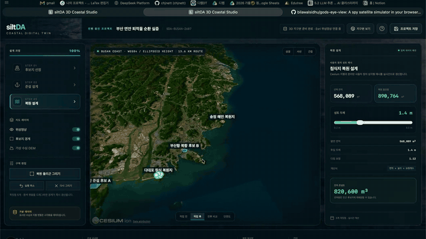
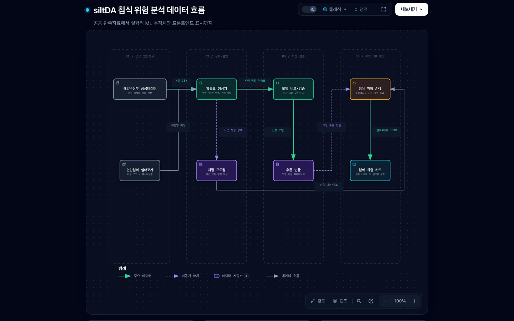
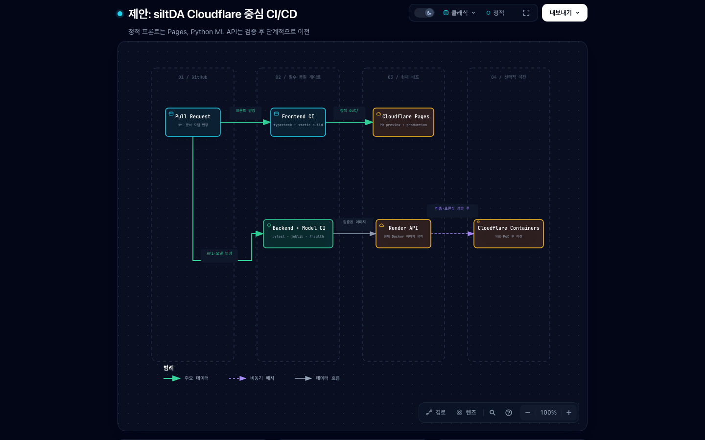

<div align="center">

# siltDA 3D Coastal Studio

### 준설토의 이동과 해안 복원을 하나의 3D 디지털 트윈으로

부산 연안을 무대로 준설 구역과 침식 복원 구역을 설계하고,<br />
굴착량·성토량·잔여량을 실시간으로 연결하는 CesiumJS 기반 프론트엔드 프로토타입입니다.

[](https://nextjs.org/)
[](https://react.dev/)
[](https://cesium.com/platform/cesiumjs/)
[](https://www.typescriptlang.org/)

</div>

## 🎬 프로젝트 데모

아래 미리보기는 자동으로 재생됩니다. 이미지를 누르면 68초 분량의 전체 무음 데모 영상을 받을 수 있습니다.

<div align="center">
  <a href="https://github.com/chjnett/siltda/raw/refs/heads/main/docs/demo/siltda-demo.mp4">
    
  </a>
  <br />
  <sub>▶ 움직이는 미리보기 · 클릭 시 전체 MP4 다운로드</sub>
</div>

## 🌊 프로젝트 소개

siltDA는 항만에서 발생하는 준설토를 매립·습지 고도 보강·조건부 해안 복원에 연결하는 설계 도구입니다. 사용자는 3D 지구본에서 후보지를 탐색하고, 준설 및 활용 경계를 직접 그린 뒤 깊이와 두께를 조절해 토량의 균형을 즉시 확인할 수 있습니다.

### 설계 흐름

1. **후보지 탐색** — 지구에서 대한민국, 부산 연안까지 이어지는 카메라 시퀀스로 대상지를 탐색합니다.
2. **준설 설계** — 항만 내 준설 경계와 굴착 깊이를 설정하고 발생 토량을 계산합니다.
3. **복원 설계** — 침식 해안의 복원 경계와 성토 두께를 설정해 필요 토량을 산출합니다.
4. **토량 균형 확인** — 준설량과 복원량을 연계해 잔여량 또는 부족량을 실시간으로 확인합니다.

## ✨ 주요 기능

| 영역 | 기능 |
| --- | --- |
| 3D 탐색 | 지구 → 대한민국 → 부산 카메라 시퀀스, 상공·사선·근접 시점 |
| 후보지 분석 | 항만 준설 후보와 침식 복원 후보 폴리곤, 대상 선택 및 자동 이동 |
| 구역 설계 | 다각형 입력, 꼭짓점 드래그 수정, 실행 취소, 삭제 후 재작성 |
| 시뮬레이션 | 굴착 깊이·성토 두께 변경, 사용자 정의 삼각형 메시 실시간 재생성 |
| 결과 비교 | 작업 전·작업 후·전후 비교·단면도 모드 |
| 물량 계산 | 준설량·복원량·잔여량 또는 부족량 실시간 계산 |
| 침식 위험 분석 | 공공 관측 이력과 실험적 ML 추정치를 분리해 표시 |
| 프로젝트 관리 | 브라우저 로컬 저장, 인트로 다시 보기, 전 단계 해양 영상 배경 |
| 운영 콘솔 | 공급·수요 CRUD, 매칭 승인 상태, 문서·공간 데이터, 기관 역할, 감사 이력 |

## 🧑‍💼 운영 콘솔

`/operations`는 3D 설계 화면과 분리된 운영 업무 공간입니다. 현재 디자인 시스템을 그대로 사용하면서 다음 흐름을 제공합니다.

1. 항만 운영자, 복원 기관, 관리자 역할 전환
2. 준설토 공급과 매립·습지·조건부 양빈 수요 등록·수정·삭제·검색
3. 초안부터 토양오염 시험 검토, 승인, 계약, 운송, 활용 완료까지 상태 전환
4. 프로젝트별 시험성적서·허가서·계약서 메타데이터 관리
5. GeoJSON `FeatureCollection` 구조와 피처 수 브라우저 검증
6. 기관 구성원과 변경 이력 확인
7. 운영 상태 JSON 보고서 내보내기

`NEXT_PUBLIC_SILTDA_OPERATIONS_API_URL`이 없으면 기능 검증을 위해 `localStorage` 저장소를 사용하고 화면에 **로컬 시연**으로 표시합니다. 환경 변수가 설정되면 `/api/bootstrap`과 `/api/snapshot`을 제공하는 Cloudflare Worker 저장소를 사용합니다.

Cloudflare 운영 API 초안은 `workers/operations-api/`에 있습니다.

- D1: 기관, 사용자, 공급·수요, 매칭 상태, 문서 메타데이터, 감사 이력
- R2: 시험성적서, 허가서, 계약서와 공간 데이터 원본
- Cloudflare Access: 이메일 기반 운영 사용자 인증

Worker 생성과 마이그레이션 절차는 [`workers/operations-api/README.md`](./workers/operations-api/README.md)를 참고하세요. Worker는 Cloudflare Access와 실제 사용자 이메일 연결 전까지 `API_ENABLED=false`로 잠기며, 이때 프론트는 명시적인 로컬 시연 저장소로 전환됩니다.

## 🧭 침식 위험 분석 흐름

PR #1에는 해양수산부 공공데이터를 정제해 관측 이력과 실험적 침식 위험 추정치를 제공하는 독립 FastAPI 모듈이 포함되어 있습니다. 프론트엔드는 두 값을 같은 카드 안에서도 명확히 구분하며, ML 결과를 공식 위험 판정처럼 사용하지 않습니다.

<div align="center">
  <a href="./docs/architecture/erosion-ml-pipeline.html?theme=light">
    
  </a>
  <br />
  <sub>Archify 원본 HTML은 코드 근거, 테마 전환, 단계별 탐색을 지원합니다.</sub>
</div>

- 정제 후 데이터는 55개 지점의 279개 관측 구간입니다.
- 선정된 `lightgbm_huber` 모델의 교차검증 MAE는 2.15%p/년이며, 중앙값 기준선 2.07%p/년보다 우수하지 않습니다.
- 따라서 관측 이력이 주 정보이고 ML 예측은 탐색적 참고값입니다.
- 데이터 출처, 누수 방지 규칙, 재현 방법은 [백엔드 문서](./backend/README.md)에 정리되어 있습니다.

## 🛠 기술 스택

- **Frontend** — Next.js 16, React 19, TypeScript
- **3D/GIS** — CesiumJS, Esri World Imagery, GeoJSON 호환 좌표
- **Geometry** — Earcut 기반 삼각분할 및 사용자 정의 변형 메시
- **ML API** — FastAPI, scikit-learn, LightGBM, joblib
- **Styling** — 반응형 해양 연구·공공 GIS 콘솔 UI

## 🚀 시작하기

### 요구 사항

- Node.js 20 이상
- npm

### 설치 및 실행

```bash
git clone https://github.com/chjnett/siltda.git
cd siltda
npm install
npm run dev
```

브라우저에서 [http://localhost:3000](http://localhost:3000)을 엽니다.

### 프로덕션 검증

```bash
npm run typecheck
npm run build
```

Cesium의 Worker, Assets, Widgets, ThirdParty 런타임 파일은 `postinstall`과 `build` 단계에서 `public/cesium`으로 복사됩니다.

### 백엔드 검증

```bash
cd backend
python3.12 -m venv .venv
source .venv/bin/activate
python -m pip install -r requirements.txt
python -m pip check
python -m pytest -q
```

`requirements.txt`는 커밋된 joblib 모델을 만든 `requirements-serve.txt`의 정확한 NumPy·scikit-learn·LightGBM 버전을 상속합니다. 이 핵심 버전을 바꿀 때는 모델을 다시 학습하고 실제 모델 테스트를 통과한 새 아티팩트를 함께 커밋해야 합니다.

## 🗺 지도 공급자와 대체 경로

기본 실행에는 API 키가 필요하지 않습니다.

1. 로컬 Cesium Natural Earth 자산을 먼저 표시합니다.
2. 연결 가능하면 키가 필요 없는 Esri World Imagery를 위성영상 레이어로 추가합니다.
3. Esri 레이어가 실패해도 로컬 지구본은 유지됩니다.
4. `NEXT_PUBLIC_CESIUM_ION_TOKEN`이 있으면 Cesium World Terrain을 사용합니다.
5. `NEXT_PUBLIC_GOOGLE_MAPS_KEY`가 있으면 Google Photorealistic 3D Tiles를 추가합니다.

> Cesium ion, Google Maps Platform, Esri의 서비스 약관, 표시 의무, 할당량 및 과금 조건은 배포 주체가 별도로 검토해야 합니다. 공개 클라이언트 환경 변수는 비밀 저장소가 아니므로 공급자 콘솔에서 도메인 제한을 설정하세요.

## 📐 데이터와 높이 기준

- 위치 좌표는 GeoJSON과 호환되는 WGS84 경위도 순서 `[longitude, latitude]`를 사용합니다.
- Cesium 렌더링 높이는 WGS84 타원체고를 사용합니다.
- 현재 수심 표면은 실제 측량 자료가 없는 경우를 위한 가상 DEM이며 UI에 `가상 데이터`로 표시됩니다.
- 위성영상은 표면 영상이며 수심 데이터가 아닙니다.
- 준설·복원 변형은 Cesium 지형 타일을 직접 수정하지 않습니다. 독립적인 `Cesium.Geometry` 삼각형 메시를 만들고 슬라이더 값에 따라 정점 높이를 다시 계산합니다.
- 실제 프로젝트에서는 GeoTIFF/DEM을 서버 또는 Web Worker에서 격자로 변환한 뒤 셀별 전후 높이 차를 적분하도록 `lib/geo.ts` 계산 계층을 교체할 수 있습니다.

## 📁 프로젝트 구조

```text
app/                    Next.js 앱과 전역 스타일
components/             3D 장면 및 설계 워크플로 UI
lib/                    공간 계산, 타입, 부산 연안 데모 데이터
backend/                공공데이터 전처리, ML 학습·추론, FastAPI
public/                 Cesium 런타임 자산과 해양 영상
docs/demo/              프로젝트 데모 영상과 대표 이미지
docs/architecture/      Archify 기반 데이터·배포 설명 자료
scripts/                 Cesium 자산 복사 스크립트
```

### 주요 파일

- `components/CesiumScene.tsx` — Cesium 초기화, 지도 공급자, 후보 레이어, 입력 이벤트, 카메라 및 메시 반영
- `components/CoastalStudio.tsx` — 3단계 워크플로, 설계 패널, 계산 결과 및 프로젝트 저장
- `lib/geo.ts` — 면적·거리·삼각분할·사용자 정의 3D 변형 메시
- `lib/demoData.ts` — 부산 연안 데모 후보와 초기 프로젝트
- `app/globals.css` — 공공 GIS 콘솔 레이아웃과 반응형 스타일

## 🔄 실제 데이터로 전환하려면

1. 후보지를 실제 GeoJSON API로 교체합니다.
2. 수심 GeoTIFF를 동일 수평좌표계와 명시된 수직기준면으로 정규화합니다.
3. 폴리곤 내부 셀을 클리핑해 실제 굴착·성토 메시를 생성합니다.
4. 경사면, 다짐계수, 작업 허용 오차를 프로젝트 규칙으로 전달합니다.
5. 시뮬레이션 결과와 원본 측량 데이터를 별도 버전으로 보관합니다.

## ☁️ CI/CD 검토 결과

현재 구조에는 **프론트엔드 Cloudflare Pages + ML API Docker 배포**의 혼합 구성을 적용했습니다. Next.js는 정적 산출물 `out/`을 만들 수 있어 Pages와 잘 맞지만, 커밋된 joblib 모델은 정확한 scikit-learn 버전에 의존하므로 Python Worker로 바로 옮기기보다 컨테이너 경로를 유지하는 편이 재현성이 높습니다.

<div align="center">
  <a href="./docs/architecture/cloudflare-cicd-proposal.html?theme=light">
    
  </a>
  <br />
  <sub>현재 저장소에 반영된 CI/CD 구조입니다. Cloudflare 계정 값 등록 후 운영 배포가 활성화됩니다.</sub>
</div>

구축된 흐름은 다음과 같습니다.

1. PR과 `main`에서 프론트 `typecheck/build`, 백엔드 `pytest`와 실제 joblib 로드, Docker 이미지 빌드를 실행합니다.
2. 세 검사를 통과한 `main`의 동일한 `out/` 아티팩트만 Cloudflare Pages에 배포합니다.
3. ML API는 `render.yaml`과 Docker 이미지를 유지합니다.
4. 완전한 Cloudflare 구성이 필요하면 동일 이미지를 Cloudflare Containers에서 PoC한 뒤 비용·콜드 스타트·모델 메모리를 비교합니다.

Cloudflare 프로젝트 생성, GitHub 환경 비밀 값, 브랜치 보호 설정은 [배포 설정 가이드](./docs/deployment/cloudflare-pages.md)를 따릅니다.

## 🔀 Pull Request 및 병합 규칙

`main`은 항상 배포 가능한 상태를 유지합니다. 직접 푸시는 원칙적으로 금지하며, 모든 변경은 작업 브랜치와 Pull Request를 거쳐 반영합니다. GitHub 저장소 설정에서는 아래 세 CI 작업을 `main`의 필수 상태 검사로 등록합니다.

- `Frontend / typecheck and static build`
- `Backend / tests and model compatibility`
- `Backend / production container build`

### 브랜치와 PR 작성

- 브랜치는 목적에 맞게 `feature/`, `fix/`, `docs/`, `ci/` 접두사를 사용합니다. Codex가 만드는 브랜치는 `codex/`를 사용합니다.
- 하나의 PR에는 하나의 목적만 담고, 기준 브랜치는 `main`으로 설정합니다.
- PR 본문에는 변경 이유와 요약, 영향 범위, 실행한 검증과 결과를 기록합니다.
- 화면이 달라지면 스크린샷이나 영상을 첨부합니다.
- 설정이나 배포가 달라지면 필요한 환경 변수의 **이름만** 기록하고 값과 토큰은 절대 올리지 않습니다.

### 데이터와 ML 모델 변경

- 실제 데이터와 합성·데모 데이터를 명확히 구분하고 출처, 좌표계, 높이 기준면, 한계를 기록합니다.
- Python 런타임 또는 scikit-learn 등 모델 의존성 버전을 바꾸면 같은 환경에서 모델을 다시 학습하고 새 joblib 아티팩트를 함께 커밋합니다.
- 모델, 전처리기, 평가 지표, 그래프 및 데이터 보고서는 같은 PR에서 함께 갱신합니다.
- 커밋된 모델을 실제로 로드해 예측하는 백엔드 테스트가 통과해야 합니다.

### 검토와 병합

- 필수 CI가 실패했거나 실행 중인 PR, 해결되지 않은 리뷰 의견이 있는 PR은 병합하지 않습니다.
- 마이그레이션, 환경 변수, 배포 영향이 문서화되지 않은 변경은 병합하지 않습니다.
- 승인 후에는 커밋 이력을 간결하게 유지하도록 **Squash and merge**를 권장하고, 병합된 작업 브랜치는 삭제합니다.
- 배포는 세 필수 검사를 모두 통과한 `main` 커밋에 대해서만 실행합니다. 외부 포크 PR에는 배포 비밀 값을 전달하지 않습니다.

PR을 만들 때는 [Pull Request 템플릿](./.github/pull_request_template.md)의 체크리스트를 완료합니다.

## 🙌 참고

[God's Eye View](https://github.com/bilawalsidhu/gods-eye-view)의 지도 공급자 분리, 실패 시 대체 경로, `flyTo` 카메라 이동, 레이어 표시 상태 관리 패턴을 분석해 프로젝트 성격에 맞게 적용했습니다. 항공기 추적, 군사용 HUD 및 감시 기능은 사용하지 않았습니다.

---

<div align="center">
  <strong>siltDA</strong> · Dredged sediment to coastal restoration
</div>
