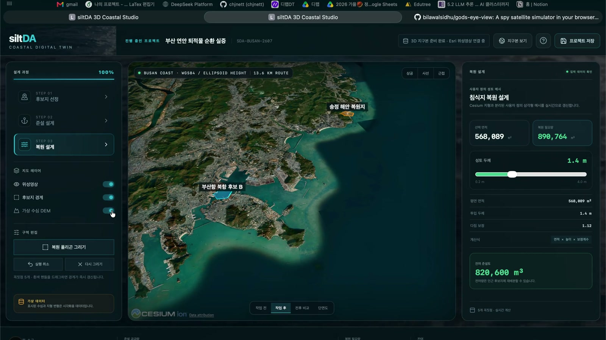

<div align="center">

# siltDA 3D Coastal Studio

### 준설토의 이동과 해안 복원을 하나의 3D 디지털 트윈으로

부산 연안을 무대로 준설 구역과 침식 복원 구역을 설계하고,<br />
굴착량·성토량·잔여량을 실시간으로 연결하는 CesiumJS 기반 프론트엔드 프로토타입입니다.

[](https://nextjs.org/)
[](https://react.dev/)
[](https://cesium.com/platform/cesiumjs/)
[](https://www.typescriptlang.org/)

</div>

## 🎬 프로젝트 데모

아래 이미지를 누르면 68초 분량의 무음 데모 영상을 볼 수 있습니다.

<div align="center">
  <a href="./docs/demo/siltda-demo.mp4">
    
  </a>
  <br />
  <sub>▶ 이미지를 클릭해 데모 영상 재생</sub>
</div>

## 🌊 프로젝트 소개

siltDA는 항만에서 발생하는 준설토를 해안 복원의 자원으로 연결하는 설계 도구입니다. 사용자는 3D 지구본에서 후보지를 탐색하고, 준설 및 복원 경계를 직접 그린 뒤 깊이와 두께를 조절해 토량의 균형을 즉시 확인할 수 있습니다.

### 설계 흐름

1. **후보지 탐색** — 지구에서 대한민국, 부산 연안까지 이어지는 카메라 시퀀스로 대상지를 탐색합니다.
2. **준설 설계** — 항만 내 준설 경계와 굴착 깊이를 설정하고 발생 토량을 계산합니다.
3. **복원 설계** — 침식 해안의 복원 경계와 성토 두께를 설정해 필요 토량을 산출합니다.
4. **토량 균형 확인** — 준설량과 복원량을 연계해 잔여량 또는 부족량을 실시간으로 확인합니다.

## ✨ 주요 기능

| 영역 | 기능 |
| --- | --- |
| 3D 탐색 | 지구 → 대한민국 → 부산 카메라 시퀀스, 상공·사선·근접 시점 |
| 후보지 분석 | 항만 준설 후보와 침식 복원 후보 폴리곤, 대상 선택 및 자동 이동 |
| 구역 설계 | 다각형 입력, 꼭짓점 드래그 수정, 실행 취소, 삭제 후 재작성 |
| 시뮬레이션 | 굴착 깊이·성토 두께 변경, 사용자 정의 삼각형 메시 실시간 재생성 |
| 결과 비교 | 작업 전·작업 후·전후 비교·단면도 모드 |
| 물량 계산 | 준설량·복원량·잔여량 또는 부족량 실시간 계산 |
| 프로젝트 관리 | 브라우저 로컬 저장, 인트로 다시 보기, 전 단계 해양 영상 배경 |

## 🛠 기술 스택

- **Framework** — Next.js 16, React 19, TypeScript
- **3D/GIS** — CesiumJS, Esri World Imagery, GeoJSON 호환 좌표
- **Geometry** — Earcut 기반 삼각분할 및 사용자 정의 변형 메시
- **Styling** — 반응형 해양 연구·공공 GIS 콘솔 UI

## 🚀 시작하기

### 요구 사항

- Node.js 20 이상
- npm

### 설치 및 실행

```bash
git clone https://github.com/chjnett/siltda.git
cd siltda
npm install
npm run dev
```

브라우저에서 [http://localhost:3000](http://localhost:3000)을 엽니다.

### 프로덕션 검증

```bash
npm run typecheck
npm run build
```

Cesium의 Worker, Assets, Widgets, ThirdParty 런타임 파일은 `postinstall`과 `build` 단계에서 `public/cesium`으로 복사됩니다.

## 🗺 지도 공급자와 대체 경로

기본 실행에는 API 키가 필요하지 않습니다.

1. 로컬 Cesium Natural Earth 자산을 먼저 표시합니다.
2. 연결 가능하면 키가 필요 없는 Esri World Imagery를 위성영상 레이어로 추가합니다.
3. Esri 레이어가 실패해도 로컬 지구본은 유지됩니다.
4. `NEXT_PUBLIC_CESIUM_ION_TOKEN`이 있으면 Cesium World Terrain을 사용합니다.
5. `NEXT_PUBLIC_GOOGLE_MAPS_KEY`가 있으면 Google Photorealistic 3D Tiles를 추가합니다.

> Cesium ion, Google Maps Platform, Esri의 서비스 약관, 표시 의무, 할당량 및 과금 조건은 배포 주체가 별도로 검토해야 합니다. 공개 클라이언트 환경 변수는 비밀 저장소가 아니므로 공급자 콘솔에서 도메인 제한을 설정하세요.

## 📐 데이터와 높이 기준

- 위치 좌표는 GeoJSON과 호환되는 WGS84 경위도 순서 `[longitude, latitude]`를 사용합니다.
- Cesium 렌더링 높이는 WGS84 타원체고를 사용합니다.
- 현재 수심 표면은 실제 측량 자료가 없는 경우를 위한 가상 DEM이며 UI에 `가상 데이터`로 표시됩니다.
- 위성영상은 표면 영상이며 수심 데이터가 아닙니다.
- 준설·복원 변형은 Cesium 지형 타일을 직접 수정하지 않습니다. 독립적인 `Cesium.Geometry` 삼각형 메시를 만들고 슬라이더 값에 따라 정점 높이를 다시 계산합니다.
- 실제 프로젝트에서는 GeoTIFF/DEM을 서버 또는 Web Worker에서 격자로 변환한 뒤 셀별 전후 높이 차를 적분하도록 `lib/geo.ts` 계산 계층을 교체할 수 있습니다.

## 📁 프로젝트 구조

```text
app/                    Next.js 앱과 전역 스타일
components/             3D 장면 및 설계 워크플로 UI
lib/                    공간 계산, 타입, 부산 연안 데모 데이터
public/                 Cesium 런타임 자산과 해양 영상
docs/demo/              프로젝트 데모 영상과 대표 이미지
scripts/                 Cesium 자산 복사 스크립트
```

### 주요 파일

- `components/CesiumScene.tsx` — Cesium 초기화, 지도 공급자, 후보 레이어, 입력 이벤트, 카메라 및 메시 반영
- `components/CoastalStudio.tsx` — 3단계 워크플로, 설계 패널, 계산 결과 및 프로젝트 저장
- `lib/geo.ts` — 면적·거리·삼각분할·사용자 정의 3D 변형 메시
- `lib/demoData.ts` — 부산 연안 데모 후보와 초기 프로젝트
- `app/globals.css` — 공공 GIS 콘솔 레이아웃과 반응형 스타일

## 🔄 실제 데이터로 전환하려면

1. 후보지를 실제 GeoJSON API로 교체합니다.
2. 수심 GeoTIFF를 동일 수평좌표계와 명시된 수직기준면으로 정규화합니다.
3. 폴리곤 내부 셀을 클리핑해 실제 굴착·성토 메시를 생성합니다.
4. 경사면, 다짐계수, 작업 허용 오차를 프로젝트 규칙으로 전달합니다.
5. 시뮬레이션 결과와 원본 측량 데이터를 별도 버전으로 보관합니다.

## 🙌 참고

[God's Eye View](https://github.com/bilawalsidhu/gods-eye-view)의 지도 공급자 분리, 실패 시 대체 경로, `flyTo` 카메라 이동, 레이어 표시 상태 관리 패턴을 분석해 프로젝트 성격에 맞게 적용했습니다. 항공기 추적, 군사용 HUD 및 감시 기능은 사용하지 않았습니다.

---

<div align="center">
  <strong>siltDA</strong> · Dredged sediment to coastal restoration
</div>
