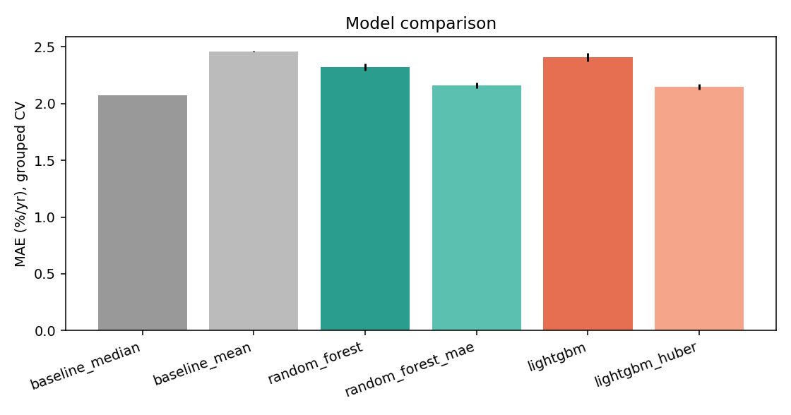
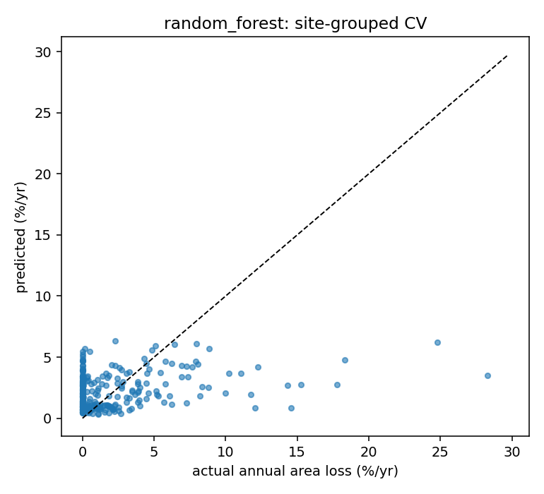
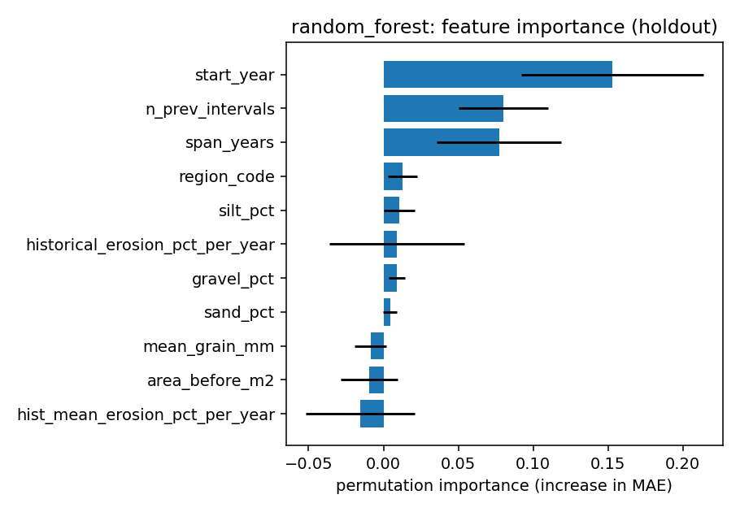

# siltDA erosion-risk ML backend

> **결론부터:** 공공 관측 이력은 서비스에 사용할 수 있지만, 현재 ML 모델은 중앙값 기준선을 이기지 못합니다. API와 프론트엔드는 이 둘을 분리해 제공하며 ML 값에는 실험적 추정치라는 경고를 유지합니다.

<p align="center">
  <a href="../docs/architecture/erosion-ml-pipeline.html?theme=light">
    
  </a>
  <br />
  <sub>Archify 원본 HTML에는 코드 근거와 단계별 탐색이 포함되어 있습니다.</sub>
</p>

Independent module (no dredge-optimisation logic). For a coast site it returns

1. **measured history** from public data (long-term / last-interval beach-area change) and a provisional class, and
2. an **experimental ML estimate** of annual beach-area loss (%/year).

**Read this first:** with the public data available, the ML model does *not* beat a trivial median baseline
(see Results). The measured history is the reliable part; the ML number is shown as a reference only.

## Run

```bash
pip install -r requirements.txt
python -m siltda_ml.data --download     # download data.go.kr CSVs (no API key) + build training table
python -m siltda_ml.train               # baselines / RandomForest / LightGBM -> artifacts/
python -m pytest -q                     # tests (synthetic data in a temp dir)
uvicorn siltda_ml.api:app --port 8000   # Swagger: http://localhost:8000/docs
```

Env: `SILTDA_MODEL_PATH` (default `artifacts/erosion_model.joblib`), `SILTDA_CORS_ORIGINS`
(default `localhost:3000`, `127.0.0.1:3000`, `https://siltda.pages.dev`).
Frontend: `NEXT_PUBLIC_SILTDA_ML_API_URL` (must be HTTPS in production).

## Data (real, Ministry of Oceans and Fisheries via data.go.kr)

| Source | Use |
|---|---|
| [15126857 beach-area change](https://www.data.go.kr/data/15126857/fileData.do) | target, history, observed series |
| [15126862 sediment composition](https://www.data.go.kr/data/15126862/fileData.do) | grain size / sand / gravel / silt (time-matched) |
| [15126863 wave direction/height/period](https://www.data.go.kr/data/15126863/fileData.do) | site wave climate (static) |
| [15126866 river status](https://www.data.go.kr/data/15126866/fileData.do) | river inflow / basin area (static, 29 of 55 sites) |
| [15126860 survey status](https://www.data.go.kr/data/15126860/fileData.do) | site code -> beach name (mapping to the frontend) |

Cleaning: of 6,190 raw area rows only 988 have both before/after areas; after removing duplicates and cumulative
spans (e.g. 1971-2009) there are **279 intervals from 55 sites**. Wave outliers (height 38, period 1424) are dropped.
`data/processed/data_report.json` has the full audit.

Not available: coastal slope, rainfall (no data downloaded). Wave "height" is published as `측정파고길이`; units
are assumed to be metres and values were not independently verified. The wave/river attributes are static site
values (surveyed 2004-2022), not time-matched to each interval; sediment, by contrast, is strictly time-matched.

Site mapping: the public files have 8-digit site codes and beach names but **no coordinates**. The frontend maps
candidates to codes by beach name (Dadaepo east zone = `26380002`, Songjeong = `26350002`).
Songjeong has no beach-area record, so it is reported as "not analysable".

## Leakage rules

`area_after_m2` only builds the target; history features use intervals with `end_year <= start_year`; sediment uses
surveys with `survey_year <= start_year` (about two thirds of rows therefore have no sediment values); sources are
joined by site code; every evaluation split is grouped by `site_id`.

## Results (`artifacts/metrics.json`, `artifacts/figures/`)

<table>
  <tr>
    <td width="50%"></td>
    <td width="50%"></td>
  </tr>
  <tr>
    <td align="center">모델별 교차검증 MAE</td>
    <td align="center">실제값과 OOF 예측값</td>
  </tr>
  <tr>
    <td colspan="2"></td>
  </tr>
  <tr>
    <td colspan="2" align="center">선정 모델의 특성 중요도</td>
  </tr>
</table>

Site-grouped 5-fold CV x3 (mean). Target = annual beach-area loss, %/yr.

| Model | MAE | RMSE | R² | Macro-F1 |
|---|---|---|---|---|
| median baseline | **2.07** | 4.14 | -0.19 | 0.24 |
| mean baseline | 2.46 | 3.82 | -0.01 | 0.11 |
| random_forest | 2.32 | 3.67 | 0.07 | 0.33 |
| random_forest_mae | 2.16 | 3.72 | 0.04 | 0.32 |
| lightgbm | 2.41 | 3.77 | 0.01 | 0.38 |
| lightgbm_huber (selected, lowest MAE) | 2.15 | 3.72 | 0.04 | 0.37 |

No learned model beats the median baseline on MAE (`model_beats_baseline: false`); RMSE/R² gains are marginal.
The temporal split (train <= 2015, test >= 2015) gives the same picture.

Diagnostics (`metrics.json -> diagnostics`):

* 1-2 year intervals are mostly noise (std 5.2 %/yr vs 0.76 for >10 years); only ~17 % of target variance is between sites.
* Restricting to intervals >= 3 years, removing wave/river or sediment features, or predicting a site's long-run
  rate from static attributes did not produce a model that clearly beats the baseline.
* Conclusion: these public tables lack the information (storms, structures, nourishment, sub-annual surveys) needed
  for a skilful forecast. Treat ML output as exploratory.

Risk classes (LOW <1, MEDIUM 1-3, HIGH >=3 %/yr) are a hackathon rule, not an official standard.

## Synthetic mode

`python -m siltda_ml.train --synthetic` writes to `artifacts_synthetic/` with `synthetic=true` and
`data_origin=["SYNTHETIC_DEMO_ONLY"]`. Its metrics only prove the pipeline runs.

## API

`GET /health`, `POST /api/ml/erosion-risk`. Send a known `site_id` (e.g. `26380002`) to fill features from its latest
observation, or `area_before_m2` + `start_year` (+ optional features). Response includes `observed_history`,
`observed_risk`, the ML estimate and flags (`synthetic_model`, `model_beats_baseline`, `missing_features_imputed`,
`ignored_inputs`). Errors: 422 `INSUFFICIENT_DATA` / `NO_AREA_HISTORY` / invalid fields, 503 `MODEL_UNAVAILABLE`.

## Next data to add

KMA/KHOA observed waves and ASOS rainfall time-matched per interval (needs coordinates per site, which the public
files do not contain), beach-profile slope, and nourishment / structure records.

## Deploy on Render (Docker)

`render.yaml` (repo root) + `backend/Dockerfile`. Image contains only `siltda_ml/` and `artifacts/erosion_model.joblib`;
`requirements-serve.txt` pins the versions the model was pickled with (do not loosen them, or retrain and re-pin).

1. Render dashboard -> New -> Blueprint -> select this repo and branch (uses `render.yaml`, rootDir `backend`).
2. Wait for the deploy; check `https://<service>.onrender.com/health` returns `"model_loaded": true`.
3. Cloudflare Pages -> Settings -> Environment variables: `NEXT_PUBLIC_SILTDA_ML_API_URL=https://<service>.onrender.com`,
   then redeploy the frontend (the value is baked in at build time).
4. CORS: edit `SILTDA_CORS_ORIGINS` on Render if the frontend lives on another origin.

Free plan sleeps when idle, so the first request after a pause can take about a minute; open `/health` before a demo.
After retraining, commit the new `artifacts/erosion_model.joblib` and redeploy.
Local image test: `docker build -t siltda-ml backend && docker run -p 8000:8000 siltda-ml`.
